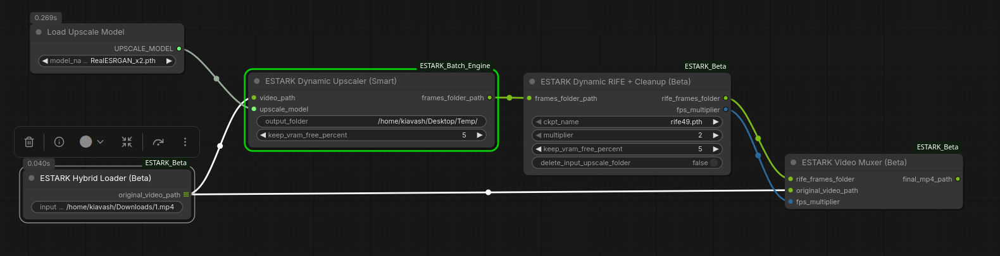

# 🎬 ESTARK Studio: Smart, Crash-Proof Video Pipeline for ComfyUI

**Built by an AI filmmaker, for creators.**

## 🚀 Quick Start (Ready-to-use Workflow)
Just want to jump in? Download the workflow and drag it into ComfyUI:
[⬇️ Download ESTARK workflow.json](workflow.json)



---

## 📖 The Story Behind ESTARK
As an art director and multimedia designer creating AI films, I hit a massive bottleneck: **VRAM limits during the upscaling and interpolation phases.** 
While the ComfyUI community offers incredible workflows, most of them assume you are running a monster PC. When I tried to upscale or interpolate (RIFE) a long video, manually guessing the "perfect" batch size was a nightmare. I either left too much performance on the table or pushed the system too hard—resulting in a devastating Out of Memory (OOM) crash hours into a render. 

I didn't want a system that pushed my GPU to the absolute edge of a cliff. I wanted a **"Set it and Forget it"** solution. I wanted to drop a folder full of videos into ComfyUI, go to sleep, and wake up to a folder of 4K, 60FPS videos with perfectly synced audio. 

That’s why I built **ESTARK Studio**. It’s not about making your hardware stronger; it’s about making your pipeline *smarter*. 

## 🛠️ The ESTARK Approach (Honest & Practical)
ESTARK Studio trades maximum hardware utilization for **100% bulletproof stability**. 
Using our custom **Progressive Warm-up** engine, the nodes start processing with a tiny batch size (e.g., 2 frames) to safely measure your GPU's real-time memory consumption. It then calculates a strict safety margin (leaving ~20% of VRAM free to prevent fragmentation) and automatically locks into the highest *safe* batch size. No more OOM anxiety.

## ✨ Key Features
* 📂 **Batch Folder Processing:** Give it a single video OR a folder full of videos. ESTARK automatically finds them, queues them, and processes the entire directory.
* 🛡️ **Auto-Gearing Engine:** Dynamically shifts batch sizes based on your available VRAM. It catches OOM risks before they happen.
* 🧹 **Smart Cleanup (Digital Vacuum):** AI video leaves massive intermediate upscale folders. ESTARK automatically deletes these heavy temporary files once the final RIFE frames are generated, keeping your SSD breathing.
* 🎬 **Background Audio Muxing:** Traditional ComfyUI audio nodes load waveforms into RAM, which is deadly for long batch renders. ESTARK's custom Muxer silently uses `FFmpeg` in the background to extract the original audio, calculate the multiplied framerate, and weave it all into a perfect, ready-to-publish `.mp4`.

## 📦 Dependencies & Installation
1. Clone or download this repository into your `ComfyUI/custom_nodes/` directory.
2. **Python Libraries:** Ensure you have the required libraries installed:
   ```bash
   pip install opencv-python numpy Pillow

   ## 📦 Dependencies & Installation
* **FFmpeg:** You **must** have FFmpeg installed and accessible in your system's PATH (used by the ESTARK Muxer).
* **Base RIFE Node:** The ESTARK RIFE node acts as a smart memory manager over the standard RIFE engine. You must have [ComfyUI-Frame-Interpolation](https://github.com/Fannovel16/ComfyUI-Frame-Interpolation) installed.

## ⚠️ Known Limitations
* **Minimum VRAM:** While ESTARK manages memory intelligently, video upscaling is inherently heavy. A minimum of 8GB VRAM is recommended.
* **Formats:** Currently, the Hybrid Loader and Muxer perform best with standard video formats (`.mp4`, `.mkv`, `.mov`).

## 🤝 Call for Feedback & Collaboration
This is my first custom node development for ComfyUI. I built it to save my own projects, but I know it can be improved. 
If you are a developer, video editor, or AI creator, please test this on your rigs. I am actively looking for feedback, bug reports (Issues), and Pull Requests to make this tool even better for the community.

*Included in this repository is a `workflow.json` and a screenshot of the canvas. Just drag, drop, and render.*

---
**License:** MIT License

comfyui, comfyui-nodes, video-processing, vram-optimization, ai-video
